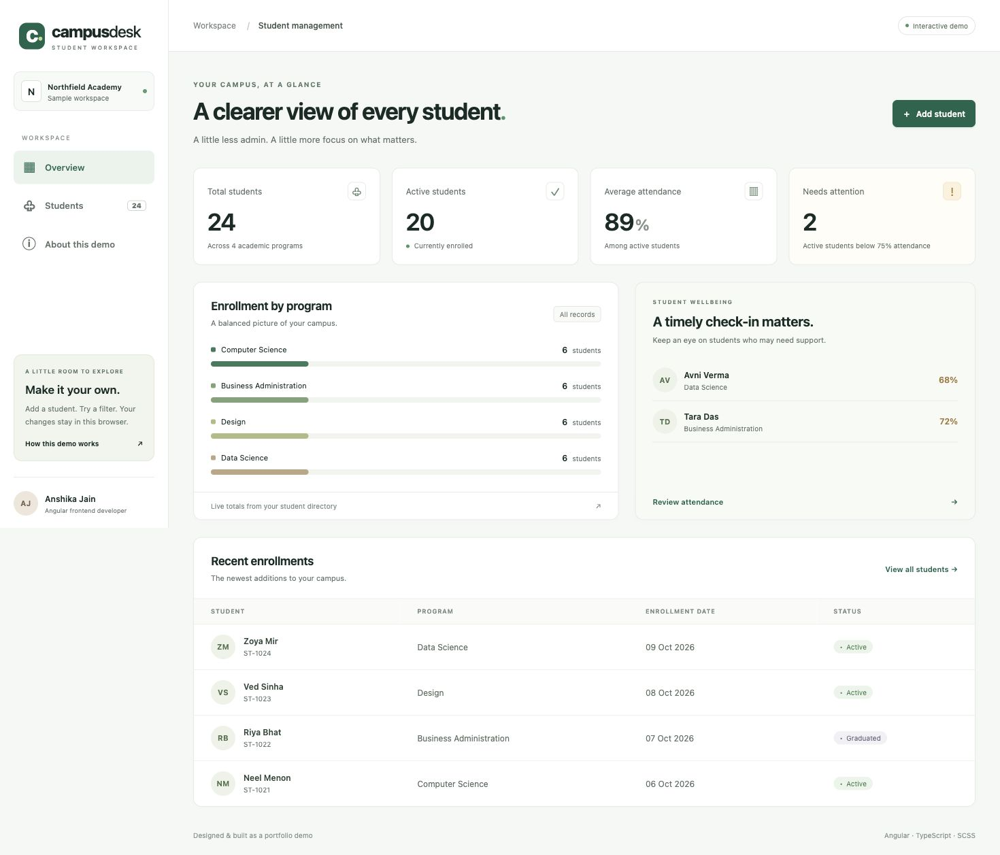

# Campus Desk

An original student-management frontend portfolio project for **Anshika Jain**, developed with AI assistance. Built to demonstrate a complete, understandable admin workflow rather than a static dashboard screenshot.

> **Demo only.** Northfield Academy and all students are fictional. This application uses browser local storage; it is not a production school system or a client project. Do not enter real personal data.

[Open the live demo](https://anshikajain-1723.github.io/campus-desk/)

## Preview



[Student directory](docs/students.png) · [Mobile view](docs/mobile.png)

## What you can try

- Overview with live student totals, program distribution and attendance alerts
- Student create/edit/delete flows with reactive form validation
- Case-insensitive unique email checks and bounded attendance values
- Combined search, program/status filters, sorting and pagination
- CSV export of filtered results with escaping and spreadsheet formula protection
- Browser persistence, corrupt-storage recovery and reset confirmation
- Responsive layouts, keyboard navigation, focus styles and native modal dialogs
- Lazy-loaded routes and OnPush components backed by a typed signal store

## Run locally

Use Node **22.22.3+ (22.x)** or another version supported by Angular 22 and npm.

```sh
npm ci
npm start
```

Open `http://localhost:4200`.

```sh
npm run build
npm test -- --watch=false
```

Production files are generated in `dist/campus-desk/browser/`.

## Architecture

```text
src/app/
  core/student.ts         Typed model, validation, filtering and CSV encoding
  core/seed.ts            Fictional sample data
  core/student-store.ts   Signal state and local-storage persistence boundary
  features/overview.ts    Derived dashboard metrics
  features/students.*     Searchable directory and reactive CRUD dialogs
  features/about.ts       Demo limitations and reset workflow
  app.routes.ts           Lazy-loaded feature routes
```

State is derived with Angular signals/computed values. Persistence is centralized in `StudentStore`; failed writes do not update in-memory records. UI validation is backed by domain checks. A future authenticated REST service should replace this persistence boundary, with authorization and validation enforced on the server.

## Testing

The unit suite covers CRUD persistence, duplicate emails, invalid data, storage failures, recovery, combined filters, reset and safe CSV output. The application shell test checks navigation. See `docs/QA.md` for manual browser checks and actual verification status.

## Deploy

The included GitHub Actions workflow builds the app and deploys the static result to GitHub Pages. In the repository's **Settings → Pages**, select **GitHub Actions** as the source. The workflow uses a repository-relative base path and copies `index.html` to `404.html` to support route refreshes on GitHub Pages. GitHub may return HTTP 404 for those fallback routes even though the app renders; use the root URL as the primary demo link.

For Netlify, build with `npm run build` and publish `dist/campus-desk/browser`. The included `_redirects` file supports SPA routes.

## Scope and limitations

No backend, real REST integration, login, roles, email, multi-device synchronization, or concurrent-tab conflict resolution is included. Attendance is an editable sample percentage, not a daily attendance engine. Browser-storage data is editable by the visitor and is not suitable for sensitive records. Accessibility-oriented interactions are implemented, but this is not a claim of formal WCAG certification. No external project source code, employer material or client data was copied.

## Credits

Implementation and visual design were created for this portfolio with OpenAI Codex assistance. Angular CLI generated the initial scaffold. Framework and dependency attribution is retained in the package lock and production license file. UI initials and the favicon are original; there are no third-party photos or illustration assets.

Useful references: [Angular signals](https://angular.dev/guide/signals) · [Reactive forms](https://angular.dev/guide/forms/reactive-forms).
